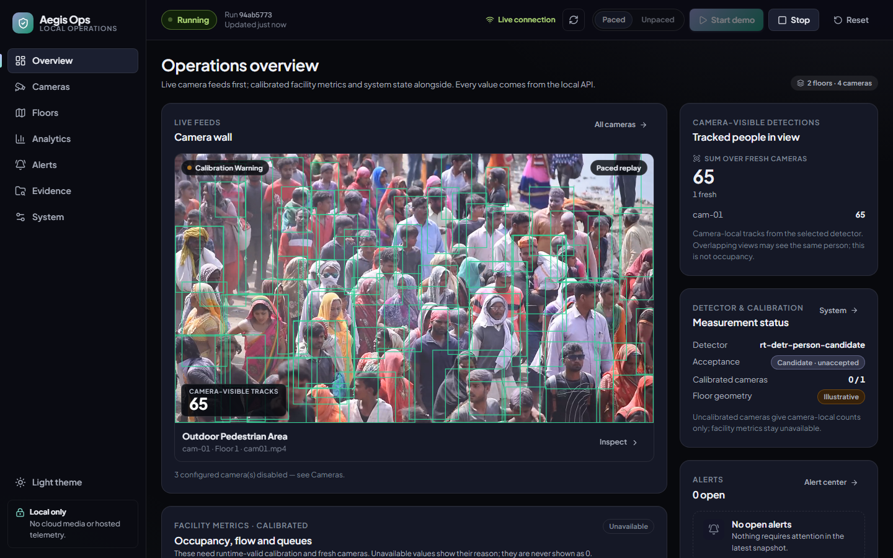

# Aegis Ops — local CCTV crowd intelligence

Aegis Ops is a local-first operations console for crowd monitoring from CCTV video. It decodes and analyses camera feeds on the GPU with NVIDIA DeepStream, tracks people per camera, turns the detections into counts, history, alerts and evidence, and shows everything on a live web dashboard.

Everything runs on one machine: no cloud services, API keys, model hosting or telemetry.



*Live on the RTX A6000 workstation: RT-DETR (FP16) + NvDCF tracking on the demo clip, replayed continuously, with the backend's tracked boxes drawn over the preview.*

## Contents

- [Highlights](#highlights)
- [How it works](#how-it-works)
- [Tech stack](#tech-stack)
- [Project status](#project-status)
- [Requirements](#requirements)
- [Getting started](#getting-started)
- [Using the dashboard](#using-the-dashboard)
- [Configuration](#configuration)
- [Testing and validation](#testing-and-validation)
- [Repository layout](#repository-layout)
- [Documentation](#documentation)
- [Data, privacy and responsible use](#data-privacy-and-responsible-use)
- [Third-party software and attribution](#third-party-software-and-attribution)

## Highlights

- **GPU video pipeline.** Hardware decode (NVDEC), TensorRT person detection and NVIDIA NvDCF tracking, in a digest-pinned DeepStream 9.2 container, one isolated container per camera.
- **File and live sources.** Local video files, replayed either paced to real time or as fast as the GPU allows, once or continuously (`loop: true`). Live RTSP cameras, with loss detection, capped-backoff reconnect and a stall watchdog. Credentials are taken from the environment and redacted everywhere.
- **Honest analytics.** Camera-visible counts and source-time history, line crossings, and, once cameras are calibrated, zone and floor occupancy, de-duplicated building figures, queues, congestion (with persistence and hysteresis), entries/exits and stair transitions. A value that can't be measured is shown as *unavailable* with its reason, never as zero.
- **Evidence.** Operator markers save the exact pipeline frame plus a short stream-copied clip, linked to an alert, with retention limits.
- **Operational safety.** Each camera starts and fails independently. Stale values go blank instead of freezing. Every container is tracked by exact name, so cleanup is confirmed even across backend crashes and restarts.
- **Reproducibility.** Every model, engine, config, parser and pipeline script is pinned by SHA-256 and checked before perception starts. Each run records its provenance.
- **Telemetry.** Real GPU, VRAM, NVDEC, temperature, power, CPU and RAM readings in the dashboard and in benchmark reports.
- **Live detection overlay.** The backend's tracked person boxes are drawn over the camera preview, kept in sync with the pipeline position (display only: counts always come from the backend).
- **Dashboard.** Camera wall, camera inspector, floors, analytics, alerts, evidence viewer and system/artifact panels. Dark and light themes, responsive from 390 to 1920 px, keyboard-operable.

## How it works

```text
Video file / RTSP camera
  │
  ▼
DeepStream 9.2 container per camera (in WSL2 or on Linux)
  NVDEC decode → TensorRT detector → NvDCF tracker
  metadata extractor: one record per frame (boxes, track IDs, source time),
  paced to real host time for paced replay
  │  stdout
  ▼
FastAPI backend (Windows or WSL/Linux)
  bounded per-camera queues → camera-local analytics on source time
  → calibration- and freshness-gated facility analytics → alerts and evidence
  → SQLite (history, alerts, evidence, provenance, container ownership)
  │  REST + WebSocket (/api/v1, /api/v1/live, /health)
  ▼
React dashboard (served by the backend from frontend/dist)
```

The browser only renders state; all counts come from the backend. The backend can run on Windows, driving the containers through `wsl.exe`, or directly inside WSL/Linux, calling Docker itself. Both routes are validated.

## Tech stack

| Layer | Technology |
| --- | --- |
| Video and AI | NVIDIA DeepStream 9.2 (pinned container image), DeepStream Service Maker (`pyservicemaker`), GStreamer (`nvv4l2decoder`, `nvstreammux`, `nvinfer`, `nvtracker`), CUDA 13, TensorRT 10.16, NvDCF tracker |
| Detectors | TrafficCamNet ResNet-18 (FP16; default of the base profile, provisional), RT-DETR r18vd (FP16 on the A6000, where it is the selected unaccepted candidate; FP32 in the base profile) and RF-DETR small (FP32, candidate), each with a custom C++ output parser |
| Containers | Docker Engine and the NVIDIA Container Toolkit inside WSL2 Ubuntu 22.04 (or native Linux) |
| Backend | Python 3.12, FastAPI, Starlette, Uvicorn, Pydantic 2, PyYAML, psutil, websockets, SQLite |
| Frontend | React 19, TypeScript, Vite, Recharts, Lucide icons, locally bundled fonts; design system adapted from OpenIntelligentUI |
| Media tooling | FFmpeg/ffprobe (evidence clips and snapshots), MediaMTX (local RTSP test server) |
| Testing | pytest, Vitest, Playwright with headless Chrome, plus project validators for live workflow, fault isolation, RTSP, routes and artifacts |

Exact pinned versions are in `backend/requirements*.txt`, `frontend/package-lock.json`, `configs/models.yaml` and [THIRD_PARTY.md](THIRD_PARTY.md).

## Project status

Developed on an RTX 5070 Ti laptop GPU (Windows 11 + WSL2) and now **running and validated on the target RTX A6000 workstation** (Windows 10 + WSL2, 2026-11-04). On the A6000 the default profile is RT-DETR with an FP16 TensorRT engine: about 68 tracked people per frame on the crowded demo clip (TrafficCamNet: about 17), 2.4 ms inference per frame, and about 220 fps for one feed through the full application. The clip replays continuously, so the dashboard stays live instead of going stale at the clip's end. The profile is `configs/a6000/` with A6000 engines in Git LFS; `Start-Aegis.cmd` selects it automatically. Measurements, rebuild and validation: [docs/rtx-a6000.md](docs/rtx-a6000.md).

**Validated with real GPU runs** (evidence under `reports/`, per-criterion status in [docs/acceptance-matrix.md](docs/acceptance-matrix.md)):

- the full single-camera workflow on the demo clip: decode, detection, tracking, live dashboard, history, evidence, exact container cleanup, crash recovery;
- both host routes (Windows backend, and backend inside WSL);
- live RTSP ingestion with loss, backoff, stall and reconnect, against a controlled local RTSP server;
- fault isolation between feeds, and paced replay held to real host time;
- the dashboard in headless Chrome at 390–1920 px;
- three timed runs per detector profile, and model/engine identity checks.

**Not yet established:**

- **Detector accuracy.** No human-reviewed labels exist yet; the annotation package is ready in `data/annotations/cam01-v1/`. TrafficCamNet is the base profile's *provisional* detector; the A6000 profile selects RT-DETR as an unaccepted candidate. Higher counts and agreement with FP32 are not accuracy measurements.
- **Calibrated facility metrics.** Occupancy, overlap de-duplication, stairs and queues need camera calibration and real multi-camera footage; only one clip exists.
- **Steady-state capacity and the 30-minute soak.** The protocol is implemented. The final run passed its first two steps and was then paused.
- **Steady-state multi-camera capacity on the RTX A6000.** Single-feed throughput and a 5-minute looping soak are measured; the multi-feed capacity protocol has not been run there.

Tests (2026-11-04, RTX A6000 PC): `scripts/check.py --require-artifacts` (with `scripts/a6000/env.ps1` for FFmpeg) passes 288 backend tests with no skips, 44 frontend tests and the production build. On the GPU, all three detector profiles complete the full clip (710/710 frames, evidence, clean container release). The independent browser check passes 17/17 for loop evidence, overlay outage/recovery, restart cursors and mobile unpaced playback; see [the workstation validation notes](docs/rtx-a6000.md).

## Requirements

- An NVIDIA GPU with a current driver. Windows 10/11 with WSL2 (validated on Windows 11 with an RTX 5070 Ti and on Windows 10 Pro for Workstations with an RTX A6000), or native x86-64 Linux.
- WSL distribution **Ubuntu-22.04** (Windows route) with Docker Engine and the NVIDIA Container Toolkit installed.
- The pinned DeepStream 9.2 image. It is pulled once by `scripts/setup/pull-deepstream.sh`, about 27 GB on disk.
- **Git LFS**, to get the footage, models and engines.
- Windows route: Python 3.12, Node.js 22+, and FFmpeg/ffprobe on `PATH` (needed only for evidence clips).
- WSL route: nothing extra. The setup script installs a project-local Python 3.12, Node.js and FFmpeg into `.install/wsl` and changes no system packages.

> TensorRT engines are specific to the GPU and TensorRT version that built them. This repository includes RTX 5070 Ti (sm120) engines and RTX A6000 (sm86) engines selected by `configs/a6000`. On other GPUs, rebuild them; see the [operations guide §2](docs/operations-guide.md#models-and-tensorrt-engines).

## Getting started

### 1. Clone with Git LFS

```bash
git lfs install
git clone https://github.com/reetamdan/time-and-motion.git
cd time-and-motion
```

Without Git LFS you get small pointer files instead of the video and models; run `git lfs pull` to fetch them.

### 2. One-time container setup (inside WSL Ubuntu-22.04)

From the project directory inside WSL:

```bash
bash scripts/setup/pull-deepstream.sh                                              # pinned DeepStream 9.2 image
bash scripts/deepstream.sh bash /workspace/scripts/setup/install-service-maker-deps.sh  # extractor's Python deps
```

### 3a. Windows route (default)

```powershell
py -3.12 -m venv .venv-windows
.\.venv-windows\Scripts\python.exe -m pip install -r .\backend\requirements.txt
npm --prefix frontend ci
npm --prefix frontend run build
.\scripts\run-backend.ps1
```

### 3b. WSL / Linux route

From the project directory inside WSL (or on a Linux host):

```bash
bash scripts/setup/install-wsl-toolchain.sh
source .install/wsl/env.sh
bash scripts/setup/setup.sh --dev --isolated-frontend
bash scripts/run-backend.sh
```

On Windows you can instead double-click **`Start-Aegis.cmd`** after steps 1-2 and the venv/frontend setup above. It sets up the environment, picks the RTX A6000 profile (`configs/a6000`) when it detects that GPU, keeps WSL (and so Docker) running while the server runs, waits for Docker, and starts the server. Stop a background server with `.venv-windows\Scripts\python.exe scripts\a6000\stop-server.py`.

### 4. Open the dashboard

Go to **http://127.0.0.1:8000/**. WSL forwards loopback to Windows. Stop the server with **Ctrl+C**.

For frontend development with hot reload on this workstation, run `Start-Aegis.cmd -Dev`: UI at http://127.0.0.1:7100/, API at http://127.0.0.1:8000/. This also selects the A6000 configuration and project Python. Before running, you can check the environment with `scripts/setup/verify-host.ps1` (Windows) and `scripts/setup/verify-environment.sh` (WSL/Linux); see [operations guide §1](docs/operations-guide.md#1-prerequisites-and-inspection).

## Using the dashboard

1. Choose **Paced** (real-time replay of the source timeline) or **Unpaced** (as fast as the GPU allows), then click **Start demo**. Tracked boxes appear over the camera preview; a camera with `loop: true` keeps running until you stop it. The first start after a reboot probes the container runtime, about 15 s; later starts take about 5 s.
2. Select a camera tile to open its inspector. It shows the live track count, source position, replay mode, rates, count history (latest window, or browse earlier and later ranges) and **Mark evidence**.
3. **Stop** releases the camera containers. **Reset** clears run-scoped history; evidence files are kept and pruned by retention.
4. If a container's removal can't be confirmed, a **Stop not confirmed** banner with **Retry cleanup** stays visible, and Start/Reset are refused until cleanup succeeds.

The same actions are available over the API, for example `POST /api/v1/demo/start?replay_mode=paced`, `POST /api/v1/demo/stop` and `GET /api/v1/facility/snapshot`; see [docs/api-contract.md](docs/api-contract.md).

## Configuration

All facility and runtime settings live in typed YAML under `configs/`:

| File | Purpose |
| --- | --- |
| `cameras.yaml` | Camera sources (file or RTSP), floors, calibration references, `loop` for continuous file replay. Four slots; `cam-01` is enabled |
| `floors.yaml`, `zones.yaml`, `portals.yaml` | Floor plans, zones, entrances and stairs |
| `analytics.yaml` | Thresholds, freshness, congestion, retention |
| `models.yaml` | Detector profiles, tracker and pipeline identities with SHA-256 pins |
| `runtime.yaml` | Host/port (loopback by default), database, evidence, replay mode, telemetry |

Validate a configuration directory before use (on Windows, use `.venv-windows`, or an existing `.venv`, in place of `.venv-wsl/bin`):

```bash
.venv-wsl/bin/python scripts/config/validate_config.py configs
```

Useful environment overrides:
- `CCTV_CONFIG_DIR`: use another config directory.
- `CCTV_DATABASE_PATH`, `CCTV_EVIDENCE_ROOT`: relocate the SQLite database and the evidence files.

To add an RTSP camera, set `source_type: rtsp` with credentials as `${VAR}` references resolved from the environment. Calibration is created from on-site measurements with `scripts/config/fit_calibration.py`. Details: [operations guide §2 and §7](docs/operations-guide.md#configuration-and-environment).

## Testing and validation

One command runs backend tests, frontend tests, typechecking and the production build with isolated test runtime paths:

```powershell
.venv-windows\Scripts\python.exe scripts\check.py --require-artifacts
```

On Linux use the project virtualenv's Python. Omit `--require-artifacts` for a checkout without downloaded LFS data; missing assets and LFS placeholders are explicitly skipped. `.github/workflows/checks.yml` runs this lightweight check on Windows and Linux for pushes and pull requests (passing since run 41726617017). Real GPU validation remains a separate workstation check.

```bash
# Backend (Windows: .\.venv-windows\Scripts\python.exe; WSL: .venv-wsl/bin/python)
python -m pytest -q tests perception/candidates

# Frontend
npm --prefix frontend test
npm --prefix frontend run build
```

If the footage or models are missing (no Git LFS), artifact-dependent tests skip and name the missing files. Set `AEGIS_REQUIRE_LOCAL_ARTIFACTS=1` to make them fail instead. FFmpeg-dependent tests separately require FFmpeg/ffprobe on PATH; on this PC, dot-source `scripts/a6000/env.ps1` first to include the per-user installation.

The project also ships end-to-end validators that use the real GPU. Each writes a new evidence directory under `reports/validation/`:

| Validator | Checks |
| --- | --- |
| `scripts/validate_live_workflow.py` | Paced and unpaced full-clip runs, history, cleanup, crash recovery |
| `scripts/validate_fault_isolation.py`, `scripts/validate_paced_lead.py` | One feed killed while the other keeps running; pacing against host time |
| `scripts/validate_rtsp_source.py` | RTSP loss, backoff, stall and reconnect |
| `scripts/validate_browser_workflow.py`, `scripts/validate_browser_evidence.py` | The dashboard in headless Chrome |
| `scripts/validate_artifact_manifest.py` | Locks and recorded-vs-recomputed artifact hashes |
| `scripts/benchmark/run_capacity.py` | Capacity and soak protocol (run via `scripts/run_supervised_batch.py`) |
| `scripts/a6000/validate-profiles.ps1` | RTX A6000: every detector profile on the full clip, evidence, history, container cleanup |
| `scripts/a6000/validate_browser_loop_overlay.py` | RTX A6000: paced run in the browser past the clip's end (looping, boxes overlay, preview sync) |
| `scripts/a6000/validate_overlay_recovery.py` | RTX A6000: loop evidence, overlay outage/recovery, restart cursors, mobile unpaced playback (isolated backend on port 8779) |

Benchmark methodology: [docs/benchmark-methodology.md](docs/benchmark-methodology.md). Full list and usage: [operations guide §3–§4](docs/operations-guide.md#3-run-and-stop).

## Repository layout

```text
backend/            FastAPI app: analytics, API, persistence, perception bridge, services
frontend/           React dashboard and design system
configs/            Camera, facility, analytics, model and runtime YAML (configs/a6000: generated RTX A6000 profile)
perception/         DeepStream configs, Service Maker extractor, candidate parsers (C++)
models/             Detector checkpoints and TensorRT engines (Git LFS)
demo/               Demo footage and derived load/soak clips (Git LFS)
data/annotations/   Annotation package for detector evaluation
scripts/            Setup, run/reset, validators, benchmarks, evaluation tools
tests/              Backend test suite
docs/               Operations guide, API contract, decisions, acceptance matrix, environment
reports/            Validation, benchmark, model-evaluation and UI evidence (raw data in Git LFS)
backend/var/        Runtime data from development runs (database, perception logs, evidence)
prd.md              Product requirements
```

Not versioned: virtual environments, `node_modules`, the `.install/` toolchains, temporary folders and key material. They are recreated by the setup commands.

## Documentation

| Document | Contents |
| --- | --- |
| [docs/rtx-a6000.md](docs/rtx-a6000.md) | The RTX A6000 workstation profile: what it changes and why, measurements, rebuild and validation |
| [docs/operations-guide.md](docs/operations-guide.md) | Complete setup, run, replay, tests, benchmarks, offline procedure, reset and retention, calibration, RTSP, troubleshooting, RTX A6000 migration |
| [docs/acceptance-matrix.md](docs/acceptance-matrix.md) | Status of every PRD acceptance criterion with its evidence |
| [docs/api-contract.md](docs/api-contract.md) | REST and WebSocket API |
| [docs/decisions.md](docs/decisions.md) | Design decisions and their limits |
| [docs/environment.md](docs/environment.md) | Hardware, drivers, container and toolchain observations |
| [docs/benchmark-methodology.md](docs/benchmark-methodology.md) | Capacity protocol, gates and reporting |
| [docs/annotation-guide.md](docs/annotation-guide.md) | How to review the annotation package |
| [docs/progress-notes.md](docs/progress-notes.md) | Chronological engineering log |
| [prd.md](prd.md) | Product requirements document |

## Data, privacy and responsible use

- Process only footage you are authorized to record, process and retain. The demo clip was supplied for this project and carries no redistribution rights; see `reports/media/cam01/`.
- The design deliberately excludes facial recognition, permanent biometric identity, gait identification, and demographic or emotion inference. Cross-camera identity stays `UNKNOWN` without evidence.
- Services bind to loopback by default. Exposing them on a network needs authentication, TLS and an access review first.
- Never put real RTSP credentials in YAML, `.env.example`, logs or screenshots. Use `${VAR}` references.

## Third-party software and attribution

- The dashboard's design system is adapted from **[OpenIntelligentUI](https://github.com/CopilotKit/OpenIntelligentUI)** by CopilotKit (MIT License, Copyright (c) Atai Barkai). The license text and the list of adapted files are in `frontend/src/design-system/NOTICE.md`. Only styling is used: no CopilotKit runtime, CDN or telemetry.
- NVIDIA DeepStream, TensorRT, CUDA, TrafficCamNet and the NvDCF tracker are subject to NVIDIA's license terms. The RT-DETR and RF-DETR checkpoints come from their upstream repositories (Apache-2.0 per their metadata).
- Versions, hashes, provenance and license notes for every dependency, model and artifact are in [THIRD_PARTY.md](THIRD_PARTY.md).
